# Architecture

PyTokenCalc is a pure-Python library (no compiled/Rust code) built around
one core abstraction: a `TokenCounter` interface, implemented once per
provider, and a `TokenCounterRegistry` that picks the right implementation
for a given model string.

## Component overview

```mermaid
flowchart TD
    User["Caller code"] --> API["pytokencalc.count_tokens() / estimate_cost()\n(pytokencalc/api.py)"]
    User --> CLI["CLI: pytokencalc / pycount\n(cli.py, quick_cli.py)"]
    User --> Server["Optional REST server (flask)\n(server.py, 127.0.0.1 only, no auth)"]

    API --> Registry["TokenCounterRegistry\n(tokenizers/registry.py)"]
    CLI --> Registry
    Server --> Registry

    Registry --> Cache["TokenCounterCache\n(tokenizers/cache.py)"]
    Registry --> Discovery["ModelDiscovery\n(model_discovery.py)"]

    Registry --> OpenAI["OpenAITokenCounter\n(tiktoken, offline)"]
    Registry --> Azure["AzureOpenAITokenCounter\n(tiktoken, offline)"]
    Registry --> HF["HuggingFaceTokenCounter\n(transformers, downloads on first use)"]
    Registry --> OSS["OpenSourceTokenCounter\n(transformers fallback, downloads on first use)"]
    Registry --> Anthropic["AnthropicTokenCounter\n(live API call)"]
    Registry --> Google["GoogleTokenCounter\n(live API call)"]
    Registry --> Cohere["CohereTokenCounter\n(live API call)"]
    Registry --> Ollama["OllamaTokenCounter\n(local HTTP, localhost:11434)"]
    Registry --> LocalInf["LocalInferenceTokenCounter\n(LM Studio / LocalAI / etc, local HTTP)"]
    Registry --> Custom["CustomProviderCounter\n(user-registered HTTP endpoint)"]

    Pricing["pricing.py\nstatic USD/1M-token table"] --> API

    subgraph MCPLayer["MCP tool surface (real handlers; optional FastMCP transport)"]
        direction TB
        MCPConn["_mcp_connector.py: TokenCalculator facade"]
        MCPTools["_mcp_tools.py: 12 real tool schemas + handlers"]
        MCPConn --> MCPTools
    end
    Pricing --> MCPTools
    Registry --> MCPTools
```



## Request flow

1. `count_tokens(text, model)` (or the CLI/server) calls into
   `TokenCounterRegistry.count_tokens()`.
2. The registry auto-detects a provider from the model string (see
   `registry.py::_auto_detect_counter` and
   [docs/MODELS.md](MODELS.md#model--provider-auto-detection)), or uses an
   explicit `provider=` argument if given.
3. The selected `TokenCounter` subclass does the actual counting:
   - **Local/offline** (`openai`, `azure`): loads a `tiktoken` encoding and
     counts locally, no network call.
   - **Local-after-first-download** (`huggingface`, `opensource`): calls
     `transformers.AutoTokenizer.from_pretrained(model_id)`. This downloads
     tokenizer files from the HuggingFace Hub the first time a given model
     ID is used, then caches locally. **There is no timeout on this call**
     (see Known gaps below).
   - **API-backed** (`anthropic`, `google`, `cohere`): makes a live HTTP
     call to the provider's own token-counting endpoint and requires an API
     key.
   - **Local-network** (`ollama`, local-inference engines, custom
     providers): makes an HTTP call to a locally-running server
     (`requests.get(..., timeout=1-2)`).
4. Results are wrapped in a `TokenCountResult` (input/output/image/system/
   tool token counts, latency, cache status, provider/platform metadata)
   and cached by `TokenCounterCache` (keyed by provider/model/text; a cache
   can be injected, otherwise each registry owns one).
5. `estimate_cost()` is independent of all of the above: it looks up
   `model` in the static `PRICING_TABLE` in `pricing.py` and multiplies by
   token counts. It does not call any provider API.

## Directory layout

```
pytokencalc/
├── api.py                    # count_tokens() / estimate_cost() top-level API
├── catalog.py                 # model metadata, aliases, context limits
├── openrouter.py              # offline OpenRouter model snapshot importer
├── ledger.py                  # optional JSONL usage ledger
├── preflight.py               # chat/tool/image preflight
├── reconcile.py               # provider usage normalization/reconciliation
├── pricing.py                 # static USD pricing table + Usage/CostBreakdown
├── model_discovery.py         # pattern-based provider/model suggestions
├── cli.py, quick_cli.py       # `pytokencalc` and `pycount` entry points
├── server.py                  # optional Flask REST server
├── statguardian_integration.py# quality-contract validation (see caveat below)
├── okf_token_baselines.py     # token-count baseline/ratio estimation
├── _mcp_connector.py          # MCP tool surface facade (real; optional FastMCP)
├── _mcp_tools.py              # MCP tool schemas + real handlers (12 tools)
└── tokenizers/
    ├── base.py                # TokenCounter / TokenCountResult ABC
    ├── registry.py             # provider auto-detection + routing
    ├── cache.py                # result caching
    ├── openai_counter.py, azure_openai_counter.py,
    │   huggingface_counter.py, opensource_counter.py,
    │   anthropic_counter.py, google_counter.py, cohere_counter.py,
    │   ollama_counter.py, local_inference_counter.py,
    │   custom_provider_counter.py    # one TokenCounter per provider family
    ├── encoding_fingerprint.py # tiktoken encoding-drift detection
    └── streaming.py            # incremental/chunked token counting
```

## Known architectural gaps (honest, not aspirational)

- ~~**MCP subsystem is dead weight in the current package.**~~ **Rebuilt.**
  `TokenCalculator` (`_mcp_connector.py`) and the handlers in
  `_mcp_tools.py` were fake stubs (hardcoded `len(text)//4` counts, fixed
  `0.01`/`0.03` rates, fixed budget/usage numbers) and shipped a connector
  that shelled out to an external `dab` binary (with a `statguardian`
  fallback) that is not a dependency of this package. In this pass the fake
  layer was removed and rebuilt for real: handlers now use the actual
  `TokenCounterRegistry` for counts and the static `pricing` table for
  costs, and are covered by `tests/test_mcp_tools.py` (23 tests). An optional
  FastMCP transport (`pytokencalc/mcp_server.py`, extra `[mcp]`) serves the
  same tools over stdio/HTTP; without FastMCP installed,
  `TokenCalculator.create_mcp_server()` raises an actionable
  `MCPUnavailable`. You can still drive `get_tools()`/`get_handler()` from
  your own MCP host. Budget tracking and usage analytics are
  in-memory/process-scoped (PyTokenCalc persists nothing).
- **No timeout on HuggingFace tokenizer downloads.** Both
  `pytokencalc/tokenizers/huggingface_counter.py:71` and
  `pytokencalc/tokenizers/opensource_counter.py:102` call
  `AutoTokenizer.from_pretrained(model_id)` with no timeout. On a machine
  with no/degraded network access and a model ID not already cached
  locally, each such call blocks for the OS-level TCP connect timeout
  (60-75 seconds observed in this sandbox) with no way for a caller of
  `count_tokens()` to bound it, and there is no retry/backoff control.
  Confirmed while validating this repo: a local test run against an
  uncached model ID sat with an open `SYN_SENT` TCP connection for well
  over a minute before the underlying library gave up.
- **`statguardian_integration.py` and `okf_token_baselines.py`** implement
  real, testable logic (contract validation dataclasses, ratio-based token
  baselines) but are separate opt-in APIs: their outputs are not used by
  `count_tokens()` / `estimate_cost()`, which remain exact tokenizer counts
  and USD pricing respectively. `okf_token_baselines.py` is exposed as
  `pytokencalc.estimate_from_baseline()` — a historical ratio estimate (not
  a tokenizer count) that returns `None` without saved baselines.

See [ROADMAP_HONEST.md](../ROADMAP_HONEST.md) for the full technical-debt
list.
